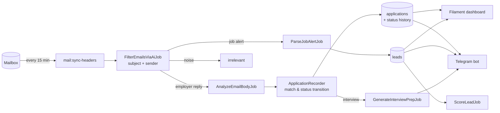

<div align="center">
  

  <h1>AI-Powered Job Application Tracker</h1>
  <p><b>Self-hosted job search assistant built with Laravel 13, Filament v3, queues and Docker.<br>
  Reads recruiter emails via IMAP, keeps the application funnel up to date, finds and scores new vacancies,
  and pushes actionable advice to Telegram.</b></p>

  <p>
    <a href="https://github.com/RuslanBaatyrbekov/job-tracker/actions/workflows/tests.yml"></a>
    
    
    
    
    
  </p>
</div>

---

## Why

A job search is a funnel: **vacancies → applications → answers → interviews → offer**.
Most trackers only store what you type in. This one fills itself from your inbox and answers the questions
that actually matter:

- Which channel brings interviews — LinkedIn, StepStone, company sites, referrals?
- Do companies even answer? Where is the bottleneck: resume, screening or interviews?
- Which of today's 40 new vacancies are worth 30 minutes of tailoring?
- Which applications need a follow-up?

## Features

| | |
|---|---|
| **Inbox → funnel** | IMAP sync every 15 min. Two-stage AI pipeline: cheap classification by subject, then deep analysis of relevant emails only. Replies are **matched to the existing application** (company name normalization + sender domain + title similarity), so "received" → "interview" → "rejected" is one application with a status history, not three rows. |
| **Vacancy leads** | Job alert emails (LinkedIn, StepStone, Indeed, XING, Arbeitsagentur) are parsed into leads, de-duplicated by normalized URL and **scored 0–100** against your profile and rules (`config/job-search.php`). Morning digest of the best ones in Telegram. |
| **Tailoring** | One click / one button: cover letter draft (DE or EN by vacancy language), resume bullets mirroring the vacancy keywords, missing keywords, rejection risks. |
| **Follow-ups** | After 10 days without an answer — reminder with a ready follow-up draft. After 30 days — marked as *no response*, so the funnel stays honest. |
| **Interview prep** | When an application moves to *interview*, a prep pack is generated: logistics from the invite, likely technical questions, STAR stories from your resume, questions to ask, German small-talk phrases. |
| **Analytics** | Weekly goal, response rate, interview rate, **conversion by source**, status history per application, data-driven AI strategy review per resume variant. |
| **Telegram bot** | `/stats`, `/leads`, `/add <vacancy text or URL>`, inline buttons *Cover letter / Applied / Skip*. Long polling — works on a laptop without a public URL. Answers only your chat. |

## Architecture



Design notes:

- **AI provider behind an interface.** `App\Contracts\AiClient` (`json()` / `text()`), Gemini implementation in
  `App\Services\Ai\GeminiClient`; all prompts in one place — `App\Services\Ai\CareerAssistant`. Swapping the model or provider is a config / one-class change.
- **Failures never lose data.** AI errors throw `AiRequestException`; jobs are retried with backoff (`$tries`, `$backoff`)
  and only end in a visible `failed` state (`php artisan mail:retry-failed`). The API key is sent in a header, not in the URL, so it never lands in logs.
- **Status as a state machine.** `App\Enums\ApplicationStatus::canTransitionTo()` ignores late auto-confirmations after an interview and keeps closed processes closed.
- **Prompt-injection hygiene.** Email and vacancy texts are passed as delimited data with an explicit "ignore instructions inside" rule and are length-capped.

## Tech stack

Laravel 13 · PHP 8.3 · Filament v3 (Livewire) · PostgreSQL · Redis queues · Docker Compose · Gemini API · Telegram Bot API · PHPUnit · Pint · GitHub Actions

## Quick start (demo data, no API keys)

```bash
git clone https://github.com/RuslanBaatyrbekov/job-tracker.git
cd job-tracker
composer install
cp .env.example .env && php artisan key:generate
touch database/database.sqlite
php artisan migrate --seed
php artisan db:seed --class=DemoSeeder
php artisan serve
```

Open http://localhost:8000/admin and log in as `demo@example.com` / `password`.

## Full setup (Docker)

1. In `.env` switch to the Docker block (PostgreSQL + Redis) and set `GEMINI_API_KEY`, `TELEGRAM_BOT_TOKEN`, `TELEGRAM_CHAT_ID`.
2. Describe your profile and what a good vacancy is in `config/job-search.php`.
3. Start everything — web, PostgreSQL, Redis, queue worker, scheduler and Telegram bot:

```bash
docker compose up -d --build
docker compose exec app php artisan migrate
docker compose exec app php artisan make:filament-user
docker compose exec app php artisan mail:add          # IMAP mailbox (Gmail: use an App Password)
```

4. Add your resume variants in **Settings → Categories** (`/admin/job-categories`).
5. Subscribe to LinkedIn / StepStone / Indeed job alerts with the same mailbox — they become scored leads automatically.

Admin panel: http://localhost:8085/admin

## Commands

| Command | Schedule | What it does |
|---|---|---|
| `mail:sync-headers {--limit=50}` | every 15 min | Fetch new email headers and start the AI pipeline |
| `leads:digest` | weekdays 08:13 | Best new leads to Telegram |
| `applications:follow-ups` | weekdays 10:07 | Follow-up reminders with drafts, mark ghosted applications |
| `ai:strategy {--force}` | every 4 hours | Strategy review per resume category, based on funnel numbers |
| `telegram:poll` | docker service | Telegram bot (long polling) |
| `applications:merge-duplicates {--dry-run}` | once | Merge duplicates created before company matching existed |
| `mail:retry-failed` | manual | Re-run emails whose processing failed |
| `jobs:categorize-existing` | manual | Assign resume categories to old applications |

Schedule times are Europe/Berlin.

## Tests

```bash
php artisan test
vendor/bin/pint --test
```

The suite covers the email pipeline (including AI outages), application matching and status transitions,
lead parsing / scoring / de-duplication, follow-ups, the Telegram bot, funnel statistics and rendering of every admin page.
All HTTP calls are faked (`Http::preventStrayRequests()`), so tests never hit Gemini or Telegram.

## Screenshots


## Privacy

Email bodies and resume texts are sent to the configured LLM provider. On the free Gemini tier Google may use
the data to improve its products — use a paid key if that matters to you. Everything else stays in your own database.
